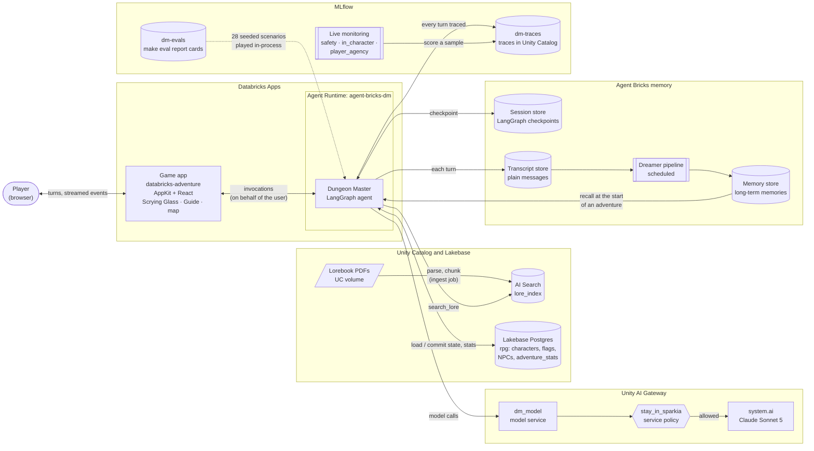
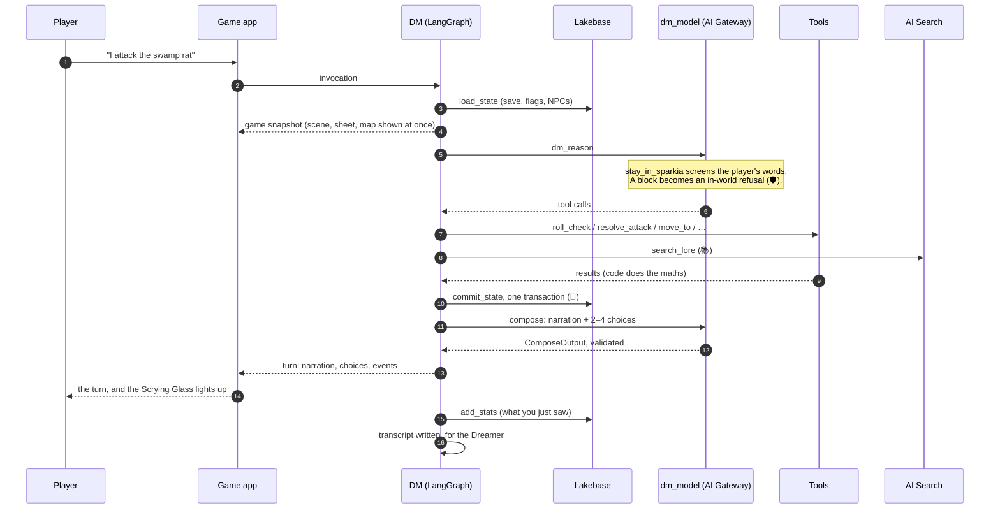

# Architecture

How the pieces of Databricks Adventure fit together. GitHub renders these diagrams from the Mermaid text, so edit them here when the architecture changes.

## The system

## One turn

## Where to read more

- The DM's graph: `dm/agent/dm_graph.py`
- Tools: `dm/agent/tools/`
- Guardrails: `dm/agent/guardrails.py` and `content/guardrails/stay-in-sparkia.md`
- Memory: `dm/agent/transcripts.py` and `dm/agent/memory.py`
- Evals and monitoring: `dm/evals/` and `dm/devtools/monitoring.py`
- The game app: `app/`
