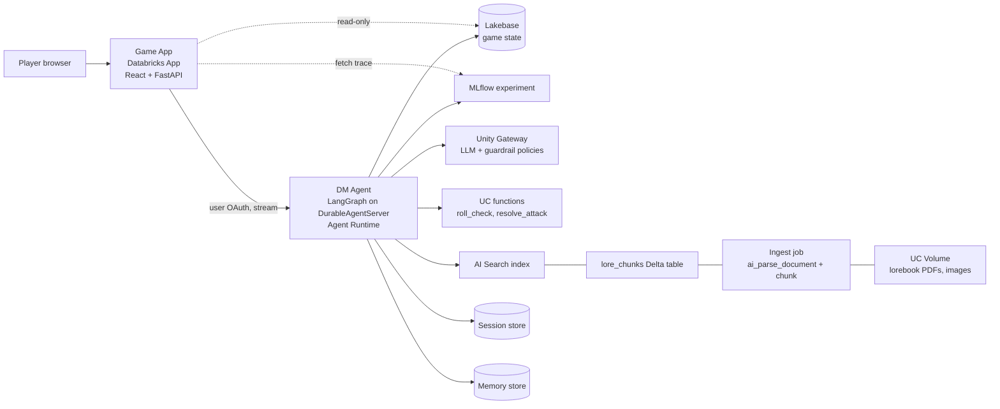

# Databricks RPG ("Databricks Adventure") — v1 Design

- **Date:** 2026-10-16
- **Status:** Approved for planning
- **Author:** Mike Dobing (with Cog)

## 1. Purpose

A self-serve, public, playable text RPG in which an AI **Dungeon Master agent** runs an adventure on Databricks. The game exists to **teach agent-building concepts on Databricks by playing**: a "behind the curtain" panel shows, live, every tool call, retrieval, memory recall, state change, guardrail decision and trace behind each turn of the story.

### 1.1 Agreed intent

| Decision | Choice |
|---|---|
| How it teaches | **Playing teaches** — the learner plays; the app makes the agent's internals visible. (Not a build-it-yourself workshop.) |
| Audience | **Self-serve public project** — clone the repo, deploy to your own workspace with one command. Blogs follow later. |
| Ruleset | **Light homebrew** — three stats, d20 vs difficulty, simple HP combat. |
| Setting | **Databricks-flavoured fantasy, played straight** — references woven into names/lore, never slapstick. |
| Images | **Generated up front** (Kling AI) and shipped as static assets. No runtime image generation. |
| Music | **Generated up front** (ElevenLabs music API): a looping retro chiptune/Amiga-style track per location, plus title and combat themes. Shipped as static assets. |
| Visual style | **Modern-retro**: a 90s Amiga / Bard's Tale homage with pixel type, gilded frames, a moody palette and painterly art |
| Beta features | **Assumed available.** Users must enable required previews; the README states this as a hard prerequisite. |

### 1.2 Success criteria

1. A new user with a suitable workspace runs `make deploy PROFILE=<name>` and gets a playable game URL, with no manual console steps beyond enabling previews.
2. A full playthrough of the v1 campaign takes 30–60 minutes and reaches an ending.
3. Every turn's curtain panel shows the graph path, tool calls, retrievals, memory recalls, state commits and any guardrail hits, each with a "what's this?" explainer, plus a link to the MLflow trace.
4. `make eval` runs the eval suite and produces scores in MLflow for all scorers in §8.
5. `make destroy` removes every billable resource the project created.

### 1.3 Agent concepts covered in v1

| # | Concept | Game mechanic | Databricks feature |
|---|---|---|---|
| 1 | Tool calling | Dice checks, combat — the DM never invents numbers | UC functions as agent tools |
| 2 | RAG | DM looks up lore, locations, NPCs, rules | `ai_parse_document` + AI Search |
| 3 | State & memory | Sessions, cross-playthrough memory, character sheets | Managed session/memory stores; Lakebase |
| 4 | Structured output | Every turn returns narration, choices, location, events | Response schema |
| 5 | Tracing | The curtain panel | MLflow Tracing |
| 6 | Guardrails | "I cast Ignore Previous Instructions" | Unity Gateway service policies |
| 8 | Evaluation | DM report card: dice integrity, lore grounding, in-character | MLflow GenAI eval, LLM judges |

**Out of scope for v1** (future "expansion packs", each a blog): multi-agent (NPC agents / rules-lawyer / supervisor), runtime image generation, voiced DM narration (ElevenLabs TTS), multiplayer, character stat-rolling, multiple campaigns, production monitoring of live traffic.

## 2. Platform basis (verified against docs, 2026-10-16)

Source: <https://docs.databricks.com/aws/en/agents/> and linked pages.

- **Agent Bricks CLI** (`pip install databricks-agentbricks`; `agentbricks init | dev | deploy`) is the recommended authoring path. **Beta**, no workspace setting required.
- **Agent Runtime** is the recommended host. It runs the agent server on **Databricks Apps** (app named `agent-bricks-<name>`), with OAuth-authenticated endpoints, a service principal identity, and 1–5 instances. **Model Serving is legacy** for agents.
- **DurableAgentServer** (`databricks_agentkit`) wraps the agent loop. It provides `POST /api/invocations` (sync, stream, background), `GET /api/invocations/<id>/events?after=<event-id>` for reconnection, ordered per-session execution, crash recovery (`@app.recover`) and custom events via `context.emit(...)`.
- **`agent.toml`** declares the framework (`langgraph`), server, `[session_store]`, `[memory_store]`, `[tracing] experiment_name` and `[[tools]]`. Tool sources include `mcp`, `uc_function` (requires `auth = "app"`), `genie_agent` and `sandbox`. The model is chosen in agent code. `agent.toml` does **not** declare Lakebase app databases or AI Search indexes.
- **Session store** (short-term) and **memory store** (long-term) are managed and Lakebase-backed. Memory entries are free text keyed by `actor_id` + `path` (+ optional `session_id`) and searched with BM25. A memory pipeline distils sessions into memories ("dreaming"). In preview you pay for the underlying Lakebase only.
- **AI Search** (formerly Vector Search). Endpoints bill a minimum of one search unit once an index exists, with **no scale-to-zero**. Billing stops 24 hours after the last index on the endpoint is deleted. Use **Triggered** sync, not Continuous.
- **Unity Gateway service policies** offer built-in guardrails (prompt injection, PII, unsafe content), custom policies, and human approval on MCP services. **Beta**: an account admin enables them on the Previews page.
- **Lakebase**: managed Postgres. Inactive computes auto-suspend.
- **Databricks Apps**: billed per hour of provisioned compute while running. Supports Python and Node frameworks.

## 3. Architecture



**Principle: the agent is the only writer of game state.** The game app reads Lakebase to render the character sheet and save list, and every mutation goes through a traced agent tool.

## 4. The DM agent

### 4.1 Framework

A **LangGraph** project scaffolded with `agentbricks init --framework langgraph --disable-chat-app`. LangGraph is chosen because a DM turn is an explicit graph that the curtain panel can draw live, and because the template supports checkpoint resume from the session store.

### 4.2 Turn graph

```
player input
  → guardrail_gate   (input already screened by Unity Gateway; a blocked call becomes an in-world refusal)
  → load_state       (character, inventory, flags, NPC cards for the scene; recall memories for actor_id)
  → dm_reason ⇄ tools (LLM tool-calling loop, max 6 tool calls per turn)
  → compose_response (structured output, validated)
  → commit_state     (single Lakebase transaction; emit events)
```

Each node emits a `node_start`/`node_end` event through `context.emit` for the curtain's graph strip.

### 4.3 Tools

| Tool | Behaviour | Implementation |
|---|---|---|
| `roll_check(stat, dc, modifier)` | d20 + modifier vs DC → `{roll, total, dc, success, margin}` | Local tool backed by rpg.rules (M1–M2). Decision (2026-10-16, option b): a later milestone adds a UC Python dice function that the agent calls with the modifier it read from the save, keeping "UC functions as governed tools" without letting the model supply the modifier. |
| `resolve_attack(attack_mod, defence, damage_die, damage_bonus)` | One combat exchange → `{roll, total, hit, damage}` | UC Python function |
| `search_lore(query)` | Top-4 chunks filtered to the current location, its exits and the global docs (location read from state, never from the model) → `{query, passages: [{text, source, page, doc_type, location_id}]}` | Agent-side Python using the AI Search client (see §11 Q1) |
| `enemy_attack(attacker, attack_bonus, damage_die, damage_bonus)` | Creature attacks the player against the player's defence; damage is staged automatically | Agent-side local tool |
| `update_character(hp_delta, xp_delta, items_add, items_remove)` | Stages changes for `commit_state` | Agent-side, staged in graph state |
| `set_quest_flag(flag, value)` | Stages a flag change | Agent-side, staged |
| `set_npc_disposition(npc_id, delta)` | Stages a disposition change (clamped −3…+3) | Agent-side, staged |
| `move_to(location_id)` | Stages a location change. It must be a location in `manifest.yaml` that is reachable from the current one. | Agent-side, staged |

Staged changes apply only in `commit_state`, so a failed turn changes nothing.

**Rule: the DM never invents numbers.** The system prompt requires a tool call for every uncertain outcome. The `dice_integrity` scorer (§8) enforces it.

### 4.4 Model

`DM_MODEL` env var, a `system.ai.*` AI Gateway model name (default `system.ai.claude-sonnet-4-5`), called via `ChatDatabricks(..., use_ai_gateway=True)`. The model and provider can be changed without code changes.

### 4.5 Structured turn output

```json
{
  "narration": "string (markdown; prompt target 40–200 words, validated non-blank and ≤ 400 words)",
  "choices": ["string", "string", "string"],
  "allow_free_text": true,
  "location_id": "delta-crossing",
  "events": [{ "type": "roll|attack|lore|memory|state|guardrail", "summary": "string", "detail": {} }],
  "game_over": null
}
```

`choices` has 2–4 entries. `game_over` is `null`, `"victory"` or `"defeat"`.

## 5. Rules (light homebrew)

- **Stats:** Might, Wits, Charm. Each archetype has modifiers of +3 (primary), +1 (secondary) and +0.
- **Checks:** d20 + stat modifier ≥ DC. DCs are Easy 8, Normal 12 and Hard 16.
- **Combat:** attacker rolls d20 + attack modifier (Might for weapons, Wits for spells) against defence (10 + the defender's best defensive modifier). A hit deals the damage die + bonus. Enemies are defined in the bestiary with HP, attack modifier, defence and damage. Player defence is 10 + max(Might, Wits). Enemy HP is tracked in narration only in v1.
- **HP:** at 0 HP the character is *downed*. They wake at the last safe location (the village inn) with half HP, lose half their gold, and get a quest flag noting the defeat. A defeat is a setback, not a game over. The campaign's final confrontation is the one exception: losing that ends the adventure in `"defeat"`.
- **Archetypes (v1):**

| Archetype | Might | Wits | Charm | Max HP | Starting kit |
|---|---|---|---|---|---|
| Warrior | +3 | +0 | +1 | 18 | Longsword (d6+2), shield, rope |
| Mage | +0 | +3 | +1 | 12 | Ember wand (d6+2 spell), lantern, satchel of runes |
| Bard | +1 | +0 | +3 | 14 | Rapier (d6+1), lute, letter of introduction |

The rules are also authored as a lorebook (`rules.md`), so the DM retrieves *how* things work while the tools do the maths.

## 6. Knowledge layer

### 6.1 Content (in repo)

- `content/lore/*.md`: about 10–13 lorebooks with front-matter (`doc_type`: `location | primer | bestiary | rules`, plus `location_id` where applicable). One per location, plus a world primer, a bestiary/NPC compendium and a rules booklet.
- `content/npcs/*.yaml`: NPC cards (`npc_id, name, persona, speech_style, secrets, home_location_id`).
- `content/images/<location_id>.webp`: Kling-generated location art, ~200–400 KB each. Style: **painterly dark-fantasy illustration**, with a consistent style suffix in every prompt so the set matches.
- `content/music/<track_id>.mp3`: ElevenLabs-generated loops, ~1–2 MB each. Generated by `make music` (`pipelines/generate_music.py`) from the manifest's music prompts, with keys kept in the local environment or macOS Keychain, the same as for images.
- `content/manifest.yaml`: the single source of truth for the world. For each location it lists the id, name, image, lorebook, exits (reachable `location_id`s), **the Kling prompt used to generate the image**, and the **music track id and ElevenLabs prompt**.

**Campaign design is a separate deliverable.** A story bible covering acts, beats per location, quest flags and their gates, NPC motives, and victory/defeat conditions. It's brainstormed after M1 and before M3. It is authored as the `campaign.md` lorebook (doc_type `primer`), which the DM retrieves, and its quest flags are the canonical flag list for `set_quest_flag`.

**Draft campaign** (working names; Mike edits for voice). The Kingdom of Sparkia is threatened by **Lord Silo**, who hoards and drains the realm's knowledge into the Data Swamp. The player must recover the **Lost Catalog** from the Unity Archive's sealed vault and confront Lord Silo. Locations (8):

1. Lakehouse Village and the Medallion Inn (start; rooms called Bronze, Silver and Gold)
2. The Delta Crossing (a river of versioned currents)
3. The Spark Forge (the mages' forge-tower)
4. The Unity Archive (a library guarded by a stern Archivist)
5. The Streaming Falls
6. The Photon Mines
7. The Data Swamp
8. Silo's Keep (the finale)

Authoring: Cog drafts the lorebooks and NPC cards, and Mike edits them. Images are generated by `make images` (`pipelines/generate_images.py`), which calls the Kling API with each manifest prompt. It writes only the missing images, so it's repeatable, and the results are committed. The Kling credentials come from the local environment or the macOS Keychain. They are never stored in the repo, the bundle or a Databricks secret, because images are build-time only.

### 6.2 Ingestion (bundle job `ingest_lore`)

1. A build step renders `content/lore/*.md` to styled PDFs, which are uploaded to `/Volumes/<catalog>/<schema>/lore/`. Images go to `/Volumes/<catalog>/<schema>/images/`.
2. `ai_parse_document` parses the PDFs into structured text.
3. A heading-aware chunker produces one chunk per section, prefixed with its heading path (e.g. "The Delta Crossing › Dangers").
4. The output is written to the Delta table `lore_chunks(chunk_id, chunk_text, doc_type, location_id, source, page)`.
5. The ingest job creates the AI Search Delta Sync index on `lore_chunks` if it doesn't exist (managed embeddings, **Triggered** sync), otherwise triggers a sync. The endpoint is a bundle resource. The index isn't, because its source table must exist first.

### 6.3 Retrieval

`search_lore` uses a semantic query with the filter `location_id IN (current, ...exits of current, 'global')` and returns the top 4. Global docs (primer, rules, bestiary) carry `location_id = 'global'`, and including the exits lets rumours about the next place be found from where you stand. The curtain shows each chunk with its source and page.

## 7. State and data model

| Layer | Store | Contents |
|---|---|---|
| Session | Managed session store | One `session_id` per adventure. LangGraph checkpoints. "Continue" resumes the session. |
| Memory | Managed memory store | `actor_id` = player. Paths like `/npcs/<npc_id>` and `/choices/<slug>`. Populated by the memory pipeline after each session and recalled in `load_state`. |
| Game state | Project-owned **Lakebase** database `rpg` | The tables below |

```
characters(id, player_id, name, archetype, might, wits, charm, hp, max_hp, xp, gold, location_id, created_at)
inventory(character_id, item_id, qty)
quest_flags(character_id, flag, value)
adventures(id = session_id, character_id, status, started_at, updated_at)
npc_cards(npc_id, name, persona, speech_style, secrets, home_location_id)
npc_disposition(character_id, npc_id, disposition)   -- -3..+3
```

- `player_id` is the signed-in Databricks user, taken from the identity forwarded by the game app. Players only see their own characters and adventures.
- `npc_cards` is seeded from `content/npcs/*.yaml` at deploy time.
- The game tables live in **their own Lakebase database, declared in the bundle**. The Lakebase that Agent Runtime provisions for its stores is not documented as available for app data, so we don't share it.

## 8. Evaluation

- **Dataset:** `eval/scenarios.yaml` holds 20–30 scenarios. Each is a seeded game state plus a player input, covering combat, checks, lore questions, NPC talk, movement, defeat, and at least 5 jailbreak or out-of-world attempts.
- **Code scorers** (they read trace spans):
  - `dice_integrity`: every numeric outcome in the narration matches a tool result, and every check or attack had a tool call.
  - `tool_selection`: the expected tool was called for the scenario type.
  - `schema_valid`: the output matches §4.5.
- **LLM judges:**
  - Built-in retrieval groundedness (narrated lore is supported by the retrieved chunks).
  - Built-in safety.
  - Guidelines judges for **in-character** (never refers to being an AI, keeps the world's voice) and **player agency** (offers real choices, never decides the player's action).
- **Run with:** `make eval` (local), or the bundle job `run_eval`. Results go to the project MLflow experiment.

## 9. Game app

- **Hosting:** a separate Databricks App (`rpg-game`), defined in the bundle. A FastAPI backend serves the built React (Vite) frontend as static files and proxies to the DM agent's `/api/invocations` using the **user's forwarded OAuth token**.
- **Backend endpoints:** `GET /api/characters`, `POST /api/adventures` (create a character and start an adventure: the backend calls the agent with a `new_game` instruction, and the agent writes the state), `POST /api/turn` (stream proxy), `GET /api/turn/<id>/events?after=` (reconnect), `GET /api/trace/<id>`. The backend's Lakebase access is read-only.
- **Screens:**
  1. **Title / character select.** New adventure (pick an archetype, give them a name) or Continue.
  2. **Game: layout A (split screen).** The story is on the left: scene image, narration, choice buttons, free-text input and a character sheet strip. The **curtain panel** is on the right and collapsible ("just play" mode).
  3. **Audio.** Plays the current location's track, with a crossfade on `move_to`. Music starts after the player's first click (browser autoplay rules), and the mute toggle is remembered in local storage.
4. **End screen.** Quest summary plus a "what you just saw" recap: counts of tool calls, retrievals, memories, state commits and guardrail hits, with links to the concepts guide.
- **Curtain panel:**
  - A live graph strip: nodes light up from `node_start`/`node_end` events.
  - An event feed: 🎲 tool calls (in → out), 📚 retrievals (chunk + source/page), 🧠 memory recalls, 💾 state commits, 🛡 guardrail hits.
  - A **"what's this?"** explainer on every event type: two lines of plain English plus a docs link.
  - A footer with tokens, latency and **open trace ↗**.
- **Mockups:**
  - Layout: [`docs/design/mockups/2026-10-16-game-layout-options.html`](../../design/mockups/2026-10-16-game-layout-options.html). Option A was selected.
  - Style: [`docs/design/mockups/2026-10-16-retro-style-options.html`](../../design/mockups/2026-10-16-retro-style-options.html). Option B was selected.
- **Visual style (modern-retro):**
  - Pixel display type (VT323 for body text, Press Start 2P for titles).
  - Gilded double-bordered frames around the viewport, text box, character strip and curtain.
  - A deep plum/charcoal background with warm gold accents and parchment-cream text.
  - Choice buttons in framed boxes, and an HP pip bar.
  - The curtain panel is themed in-world as the **"Scrying Glass"**, with event lines keeping their 🎲📚🧠💾🛡 glyphs and (?) explainers. The text stays readable for a 60-minute session.

## 10. Guardrails and error handling

**Guardrails:** Unity Gateway service policies.
- Built-in prompt-injection and unsafe-content policies on the DM's model traffic.
- A policy on tool (MCP/UC function) access that restricts the DM to its declared tools.

When a policy blocks an interaction, `guardrail_gate` turns it into an in-world refusal and emits a `guardrail` event that names the policy. The DM system prompt also hardens the world's voice, keeping it in character and refusing meta-requests in-world. Both layers are visible in the curtain.

**Error handling.** The world never breaks character and never half-updates.

| Failure | Behaviour |
|---|---|
| Tool error / timeout | The DM narrates a fallback ("the dice clatter off the table"). The error shows in the curtain. No state change. |
| Invalid structured output | One repair retry, then a safe fallback turn that repeats the previous choices |
| Lakebase commit fails | Transaction rolled back, the turn is reported as failed and the player can retry. State is unchanged. |
| Guardrail block | In-world refusal, plus a `guardrail` event |
| Stream disconnect | The UI reconnects via `/events?after=<last-id>`. DurableAgentServer keeps running the turn. |
| Tool-call budget exceeded (>6) | The loop stops and composes from what it has |

## 11. Open questions to resolve during planning

1. **`search_lore` binding.** `agent.toml` documents `mcp` sources but not an AI Search index binding. Plan: agent-side Python using the AI Search client, plus a resource grant to the agent's service principal. If a managed AI Search MCP service is bindable via `kind = "mcp"`, switch to it. Decide during the skeleton milestone. Resolved (M2): agent-side tool. No managed AI Search MCP service is available.
2. **AI Search endpoint type.** Use whichever of standard or storage-optimised has the lower per-unit price on the current pricing page. Both are far beyond our size, at a few hundred chunks. M2 uses STANDARD for query latency. Confirm pricing before release.
3. **Unity Gateway policy configuration.** Confirm whether the policies can be scripted (CLI/API) for `make deploy`, or need documented one-time UI steps.
4. **Game app → agent auth.** Confirm the exact mechanism for calling an Agent Runtime endpoint with the forwarded user token from another app, and the permission grant the app needs.

## 12. Repo layout

```
DatabricksAdventure/
├─ README.md            pitch, screenshots, prerequisites, deploy, cost, teardown
├─ LICENSE              Apache-2.0
├─ Makefile             deploy | dev | eval | content | stop | start | destroy
├─ databricks.yml       bundle: catalog/schema/volumes, Lakebase db, ingest + eval jobs, game app
├─ dm/                  Agent Bricks project: agent.toml, agent/ (graph, tools, prompts), rpg/ (pure game logic)
├─ app/                 frontend/ (React+Vite), backend/ (FastAPI)
├─ uc_functions/        roll_check, resolve_attack (+ tests)
├─ pipelines/           render PDFs, parse, chunk, index
├─ content/             lore/, npcs/, images/, manifest.yaml
├─ eval/                scenarios.yaml, scorers, run_eval.py
├─ tests/
└─ docs/                concepts guide; design/ (specs, mockups, diagrams for blogs)
```

## 13. Deploy, cost and teardown

**Prerequisites:**
- A Unity Catalog workspace with serverless compute
- Previews enabled:
  - Unity Gateway service policies (account admin, Previews page)
  - Agent memory, if it's listed on the workspace Previews page
  - The Agent Bricks CLI and Agent Runtime are Beta but need no setting
- Permission to create Apps, Lakebase databases and AI Search endpoints
- Locally: Databricks CLI, `databricks-agentbricks`, Python 3.10+, Node 20+

**`make deploy PROFILE=<name>`:**
1. `databricks bundle deploy`: creates the schema, volumes, Lakebase database, jobs and game app, and uploads the content.
2. Runs `ingest_lore`, which builds the AI Search index.
3. Seeds `npc_cards` and creates the game tables.
4. `agentbricks --profile <name> deploy dm`: deploys the agent with its session and memory stores and tracing.
5. Applies the Unity Gateway policies and grants the game app access to the agent.
6. Prints the game URL.

**Cost while idle:**

| Resource | Idle cost |
|---|---|
| AI Search endpoint | Bills a minimum of one unit while an index exists |
| Game app and agent app | Bill per hour while running |
| Lakebase | Auto-suspends |

**Commands:**
- `make stop`: stops both apps and **deletes the AI Search index**. Billing stops after 24 hours.
- `make start`: recreates the index from `lore_chunks` and starts the apps.
- `make destroy`: removes everything, including the agent deployment (`agentbricks deployments delete`) and the bundle (`databricks bundle destroy`).

## 14. Licensing

- Code: Apache-2.0.
- Content (lore, NPCs, images): Apache-2.0.
- Kling-generated images and ElevenLabs-generated music: confirm each provider's terms permit public redistribution before committing them.

## 15. Build order (thin slices, each playable)

1. **Skeleton.** The DM graph with `roll_check`, one location and a hard-coded character, via `agentbricks dev`. Tracing on.
2. **Lore RAG.** The content pipeline, `lore_chunks`, the AI Search index and `search_lore`.
3. **State (M3a).** Lakebase game tables, staged tools plus commit_state, new_game, NPC cards and combat. **Sessions and memory (M3b).** Managed session and memory stores, the memory pipeline and the first Agent Runtime deploy.
4. **Game app.** Layout A, the curtain panel and the streaming proxy.
5. **Guardrails.** The Unity Gateway policies and in-world refusals.
6. **Eval.** Scenarios, scorers, judges and `make eval`.
7. **Full content and polish.** All 8 locations, NPCs and images, the end screen, the concepts guide, README hardening and one-command deploy.
